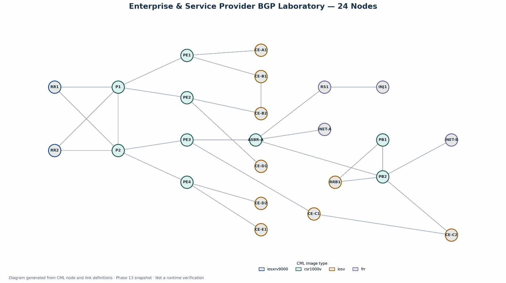

# Enterprise & Service Provider BGP Lab — 24 Nodes

**Personal networking engineering lab | Cisco Modeling Labs (CML) | Intermediate Phase 13 snapshot**

## Project overview

A 24-node multi-AS, multi-customer network laboratory designed to explore enterprise and service-provider routing, control-plane separation, MPLS forwarding, VPN route exchange, and routing-policy decisions. The snapshot uses Cisco IOS XRv 9000, CSR1000v, IOSv, and FRRouting virtual devices.

**Scope and evidence:** The saved device configurations contain OSPF, MPLS LDP, MP-BGP VPNv4, dual route reflectors, customer VRFs, CE–PE eBGP, and several route filters/attribute policies. They are evidence of *configuration work*, not proof of end-to-end operational success. Verification outputs and post-change testing are not included in the uploaded source.

## Key architecture

- **AS 65000:** Two IOS XRv 9000 route reflectors (RR1/RR2), two provider-core routers (P1/P2), four provider edges (PE1–PE4), and ASBR-A.
- **AS 65010:** PB1, PB2, and RRB1 appear in the secondary provider domain. Customer C is represented across the inter-AS boundary.
- **Customer VPNs:** CUST-A, CUST-B, CUST-C, CUST-D and CUST-E VRFs, with route targets and per-PE route distinguishers.
- **Policy examples:** Preferred-path decisions using route-maps, LOCAL_PREF, AS-path manipulation, and prefix-based filtering.
- **Internet-facing test elements:** Additional FRRouting nodes are present in the diagram; their role and live exchange require verification.

### What the snapshot demonstrates

| Area | Evidence in uploaded configuration | Verification status |
| --- | --- | --- |
| Underlay | OSPF process configuration on provider nodes | Not verified from live outputs |
| Label switching | MPLS enabled on interfaces and LDP router IDs | LDP adjacencies and LFIB not verified |
| VPN control plane | MP-BGP VPNv4 neighbors and route-reflector-client statements | BGP session/route exchange not verified |
| VPN segmentation | Customer VRFs and route-target imports/exports | End-to-end isolation not verified |
| Inter-AS customer routing | VRF-based IPv4 eBGP handoff between ASBR-A and PB2 for CUST-C | Treat as VRF-level inter-AS handoff; **not** proof of Inter-AS Option B or C |
| Route selection/policy | Route maps, prefix lists, as-override and AS-path manipulation | Desired policy effects not verified |

## Repository contents

- [`diagrams/topology.svg`](diagrams/topology.svg) — generated node/link topology from the original CML snapshot.
- [`cml/topology-only.yaml`](cml/topology-only.yaml) — CML-style topology-oriented YAML (import not independently tested); **all startup configurations removed** for public safety.
- [`configs-excerpts/`](configs-excerpts/) — selected, sanitized routing-related excerpts, **not complete configurations**.
- [`verification/verification-plan.md`](verification/verification-plan.md) — commands and evidence to capture after the lab is rebuilt.
- [`design-notes.md`](design-notes.md) — technical notes and known snapshot limitations.

## Reproducing the design

1. Attempt to import `cml/topology-only.yaml` into a licensed Cisco Modeling Labs environment with the appropriate node images; the generated import has not been tested in CML.
2. Review node/interface mappings in CML before configuration.
3. Configure the desired services from your **own authorized configurations** or use the excerpts as a reference; excerpts are intentionally incomplete.
4. Run the verification plan and capture sanitized outputs before claiming operational success.

**No Cisco software images are supplied.** Cisco product names are used to identify platform types. The project represents a personal virtual laboratory, not a production network or a customer deployment.

## Authorship and limitations

Lab design and configuration work: Zeeshan Basit. Documentation and illustration prepared with AI assistance from the author's source files. The README does not claim that the attached phase snapshot passed operational testing. Device secrets, certificates, and full original startup configurations are excluded from the public package.
